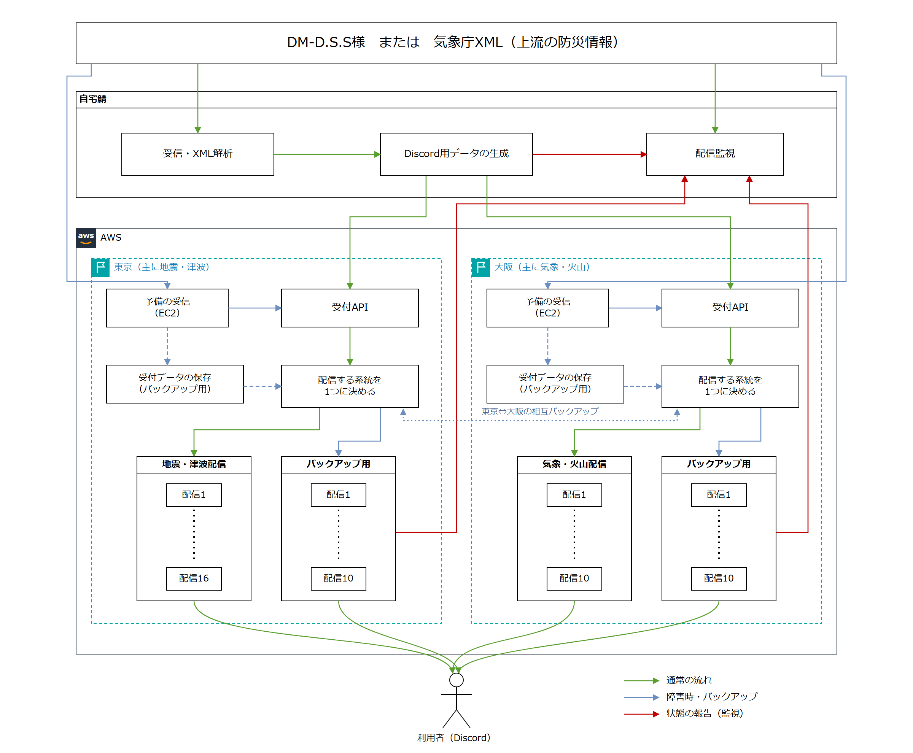
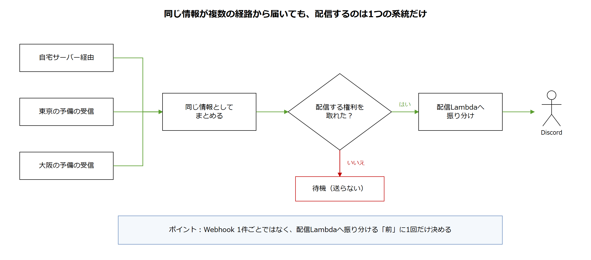
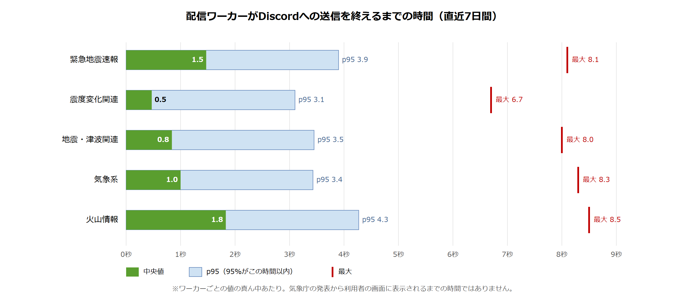
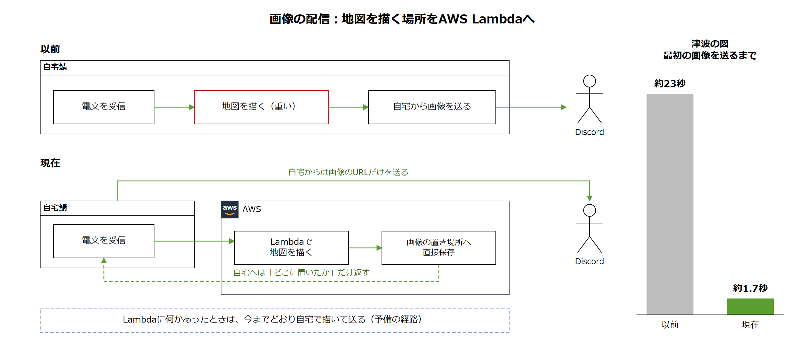

# Discordへの高速配信と冗長性の両立化

この記事は、防災アプリ開発 Advent Calendar 2026 の記事です。

初めましての方は初めまして。お久しぶりの方はお久しぶりです。

Discordに緊急地震速報や地震・津波・気象・火山情報などを配信している「DPI-Bot」を開発・運営している、孤独のコーヒーです。

2021年からほぼ毎年、防災アドベントカレンダーに参加していますが、今年もなんとか書くことができました。

ちなみに現在は大学2年生です。2021年に初めて記事を書いたときは中学生だったので、時間がたつのが早すぎますね、、、

過去の記事では、DPI-Botを作った経緯や、気象・地震情報をAWSからDiscordへ配信する仕組み、そして去年はAWSで1日400ドル請求された話（まだ思い出すと胃が痛い）などを書きました。

- [Discordでの災害情報提供（2021年）](https://qiita.com/jr226/items/5c276046eaaf2cfb1a49)
- [開発開始から約2年たったBotくん（2022年）](https://qiita.com/jr226/items/5946b79c75cb14b39e19)
- [気象・地震情報などをAWSからWebhookで配信している話（2024年）](https://qiita.com/jr226/items/9656bcde6efca862f243)
- [AWSでやらかした話。（2025年）](https://dpi-bot.com/advent/?id=20251217)

2024年の記事では、東京と大阪に配信系統を分け、たくさんのAWS Lambdaを使って高速化した話を書きました。

ただ、配信するLambdaを増やせばすべて解決するかというと、そんなに簡単ではありませんでした。

速くしようとして複数の配信経路を同時に動かすと、今度は同じ情報が2回配信される可能性があります。反対に、二重配信を恐れてバックアップを完全に止めておくと、障害が起きたときの切り替えが遅くなります。

そこで今年は、DPI-Botで行っている「Discordへの高速配信」と「冗長性」を、どのように両立しているのかを書いていきます。

毎年のことですが、趣味で作っているものなので、構成が大きすぎるとか、やりすぎでは？という部分はあると思います。

（自分でもたまに思いますｗ）

# DPI-Botについて

DPI-Botは、気象庁から発表される情報などをDiscordへ配信するBOTです。

主に次のような情報を配信しています。

- 緊急地震速報
- 地震情報
- 津波情報
- 気象警報・注意報
- 台風情報
- 火山情報
- その他の防災・災害情報

サーバーごとに、受け取りたい情報や配信先のチャンネル、対象地域などを設定できます。

今年は新しく、地震の震度分布図や気象警報の地図、雨雲レーダーなどを**画像で**配信する有料プランも始めました。
（学生バイトで維持費を払い続けるのはさすがに限界があったので、、、）

自分が2018年の北海道胆振東部地震で停電を経験し、正しい情報を少しでも早く確認できるものが欲しいと思ったことが、開発を始めたきっかけです。

当時、そのようなDiscord BOTが見つからず、「ないなら自分で作ればいいやん！」という思いから、2020年末ごろに開発を始めました。

DPI-Botを利用して、少しでも防災・減災につながってほしいという思いは、今も変わっていません。

# 防災情報の配信で「速い」だけでは足りない

地震や津波などの情報では、数秒の差でも早く届けることが重要です。

しかし、防災情報を扱う以上、平均配信時間だけを短くすればよいわけではありません。

例えば、通常時に2秒で配信できる構成でも、そのサーバーが止まった瞬間に何も配信できなくなるのであれば、防災情報の配信システムとしては不十分です。

逆に、障害対策として同じ処理を東京・大阪・自宅サーバーからすべて同時に実行すると、同じ情報を2回、3回とDiscordへ送ってしまう可能性があります。

DPI-Botでは、次の3点を同時に満たす必要がありました。

1. できるだけ早くDiscordへ配信する
2. 一部のサーバーやリージョンが停止しても配信を継続する
3. 複数経路が動いても二重配信を発生させない

言葉にすると簡単そうですが、実際に作るとこの3つがなまらぶつかります。

# 現在の配信構成

現在のDPI-Botは、自宅サーバーとAWSの東京・大阪リージョンを組み合わせて運用しています。

大まかな構成は次のようになっています。

役割は大きく分けると次のようになっています。

| 拠点・系統 | 主な役割 |
|---|---|
| 自宅サーバー | 防災情報の受信、XML解析、Discord用データの生成 |
| AWS東京リージョン | 主に緊急地震速報、地震、津波関連の受付・配信 |
| AWS大阪リージョン | 主に気象、火山関連の受付・配信 |
| 保存用の経路 | 受付データの保存、直接経路が失敗した場合のバックアップ |
| 相互バックアップ | 東京または大阪の片方で障害が起きた場合の配信継続 |

通常時は、受付APIから配信Lambdaを直接起動する高速経路を使います。

一方で、同じ受付データを別の場所にも保存しています。毎回この保存を経由してから配信すると、その分だけ待ち時間が増えるため、普段の最速経路にはしていません。

つまり、

- 速度を優先する直接経路
- データを失わないための保存経路

を分けています。

「全部保存してから送れば安全なのでは？」と思うかもしれませんが、緊急地震速報などでは少しでも待ち時間を減らしたいため、速度と耐久性を分ける形になりました。

# 自宅サーバーを優先しつつ、AWSだけでも完結できるようにする

通常時は、自宅サーバーで防災情報を受信・処理し、東京または大阪の受付APIへ送信します。

ただし、自宅には停電、回線障害、Windows Update、プログラム停止など、いろいろな停止要因があります。
（北海道の冬の停電は普通にあり得るので、、、）

自宅が止まっただけでDPI-Bot全体が止まるのは避けなければなりません。

そのため、東京・大阪のEC2側にも受信処理を用意し、自宅サーバーの停止を検知した場合はAWS側で受信からDiscord配信まで完結できるようにしています。

AWS側は、自宅からの情報を少しだけ待つようにしています。自宅から正常に届いた場合はそちらを優先し、届かなかった場合にEC2で受信した情報を受付APIへ送ります。

待ち時間を長くすれば二重処理は減りますが、切り替えが遅くなります。短くしすぎると、一時的なネットワーク遅延だけでバックアップが動いてしまいます。

また、自宅サーバーが一度応答しただけですぐ元に戻すのではなく、しばらく安定していることを確認してから通常系へ戻します。

停止の瞬間だけではなく、「復旧しかけて再び停止する」という状態も考えないと、配信経路が何度も切り替わってしまうためです。

# 東京と大阪の相互バックアップ

自宅サーバーのバックアップだけでなく、AWS内でも東京と大阪を分けています。

片方のリージョンで問題が発生した場合は、もう片方からも配信できるようにしています。

ただし、ここで単純に両方から送ると、東京と大阪の両方が成功した際に二重配信となります。

そこで必要になるのが、「どちらがこの情報を配信するのか」を決める仕組みです。

# 高速化より難しかった二重配信の防止

DPI-Botでは、一つの情報に対して、配信処理の内部で使う識別情報をいくつか付けています。

具体的な判定方法は内部仕様なのでここでは詳しく書きませんが、主に次のような情報を組み合わせています。

- 配信単位を識別する情報
- 受信元や処理経路を識別する情報
- 情報の更新状態を表す情報
- 情報種別ごとの重複判定条件

東京・大阪・自宅の複数経路から同じ情報がほぼ同時に到着しても、同一の配信としてまとめて扱い、「配信する権利」を取れた系統だけが実際の配信処理へ進みます。

ここで重要なのは、配信先のWebhook一件ごとではなく、複数の配信Lambdaへ分配する**前に**一つの情報として登録することです。

分配後に各Lambdaが別々に重複判定すると、タイミングによって一部の配信先にだけ二重に送られる可能性があります。

ただ、これだけでも完全ではありません。

DiscordへPOSTした後、通信が途中でタイムアウトすると、こちら側から見ると「送信に失敗した」のか、「Discordには届いたけれど応答だけ受け取れなかった」のか判断できない場合があります。

この状態で自動再送すると、実際には1回目が成功していて、同じ情報をもう一度投稿してしまう可能性があります。

そのため、エラーの種類によって扱いを分けています。

| 状態 | 基本的な扱い |
|---|---|
| HTTP 2xx | 配信成功 |
| 429 | Discordのレート制限に従って待機・再試行 |
| Unknown Webhookなどの404 | 無効な可能性がある配信先として記録 |
| 接続前に失敗 | 条件に応じて再試行可能 |
| 応答待ち中のタイムアウト | 配信済みの可能性があるため、むやみに自動再送しない |

速く届けることも大切ですが、同じ地震情報が短時間に何度も届くと、利用者が混乱してしまいます。

高速化と同じくらい、二重配信を防ぐことも大切だと運用を通して感じました。

# 配信Lambdaを分ける理由

DPI-Botでは、配信先のWebhookを複数のLambdaへ分散しています。

一つのLambdaから全配信先へ順番に送ると、後ろに並んだWebhookほど配信が遅くなります。

そこで、配信先を複数のグループへ分け、Lambdaから並列にDiscordへ送信しています。

配信に関わるLambdaは、東京と大阪を合わせて100本以上あります。

特に迅速性が必要な緊急地震速報や地震情報では、ほかの情報より多くの配信ワーカーへ分けています。

2024年の記事では、初期構成でAWSからDiscordへの配信完了に30秒、場合によっては1分ほどかかっていました。

当時と比べるとかなり短くなりましたが、Lambdaを増やすだけでは解決しない部分も見えてきました。

（課金最強！！！だけでは終わらなかったです、、、）

# 直近7日間の配信時間

2026年11月27日に、直近7日間のログから、配信ワーカー1本がDiscordへの送信を終えるまでの時間を集計しました。

| 配信系統 | 中央値 | p95 | 最大 |
|---|---:|---:|---:|
| 緊急地震速報 | 1.3〜1.6秒 | 3.4〜4.3秒 | 8.1秒 |
| 震度変化関連 | 0.4〜0.6秒 | 2.9〜3.6秒 | 6.7秒 |
| 地震・津波関連 | 0.7〜0.9秒 | 3.3〜3.6秒 | 8.0秒 |
| 気象系 | 0.9〜1.1秒 | 3.3〜3.6秒 | 8.3秒 |
| 火山情報 | 1.7〜2.0秒 | 4.1〜4.6秒 | 8.5秒 |

※ワーカーごとに値が少しずつ違うので、幅で書いています。ここでいう時間は、配信ワーカーがDiscordへの送信を始めてから、担当分をすべて送り終えるまでです。気象庁が発表してからの時間や、利用者の端末に表示された時刻ではありません。

普段はほとんどの配信が1〜2秒以内で送り終わっていますが、最大を見ると8秒台があります。

つまり、通常時は目標に近い時間で配信できていても、まれに一つの遅いWebhookが全体の終了時間を引き延ばしていることが分かります。

# まれに遅くなる原因

ログを確認すると、遅延の中心は主に次の2つでした。

1. Lambdaの起動待ち
2. DiscordへのHTTP通信

## Lambdaの起動待ち

Lambdaは、しばらく実行されていないと起動（いわゆるコールドスタート）に時間がかかります。

調べてみると、バックアップ用のLambdaは定期的に温めていたのに、実際に気象・火山情報を配信するLambdaの一部が温める対象から漏れていました、、、

実配信で最初の起動になった処理では起動待ちが平均1秒弱、温まっている処理では0.2秒弱と、無視できない差がありました。

そこで、実配信を行うLambdaも温める対象に追加しました。

ただし、温めるために大量に呼び出すと費用が増えるので、必要な関数に最小限の呼び出しだけを行っています。
（去年の記事を書いた人間なので、ここは本当に慎重になりましたｗ）

## 一部のWebhookだけ応答が遅い

ほとんどの配信先には1秒前後で送れていても、一件の応答待ちに8秒以上かかると、そのワーカー全体の終了時間も8秒以上になります。

平均だけを見ると問題が見えにくいですが、最大値やp95を見ると、外部HTTP通信の一部に長い待ち時間があることが分かります。

## 無効になったWebhook

DiscordサーバーからDPI-Botが退出した場合や、Webhookが削除・再作成された場合、保存しているURLが無効になることがあります。

無効なWebhookが配信先に残っていると、毎回エラー処理が発生します。

ただし、一度失敗しただけで自動削除すると、一時的なDiscord側の障害や通信エラーで、正常な配信先まで消してしまう可能性があります。

そのため、DPI-Botでは「消えた」とはっきり分かる失敗だけを数え、

- 3日間ずっと送れていない
- 1週間のうちに4回失敗した

のどちらかを満たしたものだけを自動で削除しています。レート制限や一時的な通信エラーは数えません。

また、削除したときは「どの配信の宛先が何件消えたか」を管理用のDiscordサーバーへ通知するようにしました。

速くするためにすぐ消したくなりますが、利用者の設定を誤って消さないことも同じくらい重要です。

# 2026年に行った高速化

今年はほかにも、いくつか改善を行いました。

- 配信Lambdaの共通の通信処理で、一つの通信の失敗が同じLambda内のほかの送信に影響しないようにした
- 実際に配信を行うLambdaの温める対象を見直した
- 配信速度に関係する区間の時刻を記録し、どこが遅いのかを分けて見られるようにした
- 混み合ったときは、緊急地震速報を最優先で送る順番にした

なお、HTTPのタイムアウト時間を単純に短くする変更は行っていません。

タイムアウトを短くすれば、見かけ上の最大処理時間は短くできます。しかし、少し遅れて正常に配信できるWebhookまで失敗扱いになり、情報が届かなくなる可能性があります。

「処理時間が短くなった」ことと、「利用者へ正しく届いた」ことは別です。

## 画像の配信もAWSへ

今年始めた画像の配信では、最初は地図などを自宅のPCで描いていました。

ただ、津波の図のように描くのに時間がかかるものもあり、測ってみると最初の画像を送るまでに約23秒もかかっていました。緊急性の高い情報ほど待たされるという、なんとも本末転倒な作りです、、、

（この作りで動いていたのは1週間ほどで、その間に津波の画像を配信することは一度もなかったので、実際に誰かを待たせることはありませんでした。セーフｗ）

そこで、画像を描く処理もAWS Lambdaへ移しました。

描いた画像はLambdaから直接画像の置き場所へ保存し、自宅には「どこに置いたか」だけを返すようにしています。自宅の回線を画像が往復しなくなったので、その分も速くなりました。

例えば津波の図では、最初の画像を送るまでの時間が約23秒から約1.7秒になりました。
（作業中に思わず二度見しましたｗ）

もちろん、Lambdaに何かあったときは、今までどおり自宅で描いて送る予備の経路も残しています。

ここでも「速い経路」と「止まらない経路」を分けて持つ、という考え方は同じです。

# 実際に運用して分かったこと

## 最速の1経路だけでは安定しない

通常時に最も速い経路だけを残せば、構成は簡単になります。

しかし、その経路が止まったときに配信全体が停止します。

防災情報では、平均を数百ms短くすることだけでなく、障害時にも情報を届け続けることが必要です。

## バックアップは置くだけでは動かない

バックアップ用のEC2やLambdaを作っても、実際に障害時に動くとは限りません。

権限不足、古いプログラム、設定の違い、無効なWebhookなど、通常時には見つからない問題があります。

そのため、テスト用のチャンネルを使い、実際に受付からDiscord到着までを定期的に確認する必要があります。

## 冗長化するほど重複防止が難しくなる

自宅、東京、大阪、保存用の経路、相互バックアップと経路を増やすほど、同じ情報が複数箇所に存在します。

どの経路が配信したのか、どの経路は待機すべきか、途中で処理が止まった場合に誰が引き継ぐのかを決めなければなりません。

冗長化はサーバーを増やすことより、状態を正しく管理することのほうが難しいと感じています。

## 平均値だけを信用しない

平均が速くても、一部の配信で8秒以上かかっていることがあります。

さらに、一件のWebhookだけが遅く、他のほとんどにはすでに届いている場合もあります。

平均、中央値、p95、最大値に加えて、

- 最初に配信が成功した時刻
- 何割の配信先に届いた時刻
- 最後の成功が終わった時刻

を分けて見る必要があります。

## 自動再送が正しいとは限らない

配信に失敗したら再送する、という処理は一見正しそうに見えます。

しかし、Discordには届いていて応答だけ受け取れなかった場合、自動再送が二重配信を発生させます。

エラーの種類を分け、「失敗」と「結果不明」を同じ扱いにしないことが大切でした。

# 今後行いたいこと

今後行いたいことの第1位は、やはり「もっと早く届けること」です。

以前よりかなり短い時間で配信できるようになりましたが、防災情報なので、短縮できる部分がある限り改善を続けたいと考えています。

そのほかにも、まだ改善したい部分があります。

- 配信処理をさらに高速化する
- 雷や台風、火山などの画像の配信を正式に始める（今は開発用のチャンネルで試しているところです）
- 外れ値が起きたとき、原因（Lambdaの起動待ち・Discordの応答待ち・無効なWebhookなど）を自動で分けて記録する
- バックアップ経路だけを使った定期試験を自動化する
- 障害時の切り替えと通常系への復帰条件をさらに改善する

# 最後に

2024年の記事では、配信Lambdaを増やし、AWSからDiscordへ高速に配信する構成を中心に紹介しました。

その後も運用を続け、単にサーバーやLambdaを増やすだけでは、高速で安定した配信にはならないことが分かりました。

自宅サーバー、東京、大阪、直接経路、保存用の経路を組み合わせることで、一部に障害が起きても配信を継続できます。

しかし、経路を増やすほど二重配信の可能性が高まり、どの系統が配信するのか、タイムアウト時にどう扱うのかが複雑になります。

防災情報の配信では、数百msを短縮することも大切ですが、障害が起きたときにも止まらないこと、同じ情報を何度も送らないこと、そして本当に届いたか確認できることも欠かせません。

DPI-Botでは、これからも実際の配信時間や障害時の動作を確認しながら、より速く、より安定した配信を目指して改善していきます。

毎年、記事を書く直前になって「今年は書くことないなぁ」と思っていますが、振り返ってみると今年もかなりいろいろ変わっていました。

（趣味の範囲とは、、、）

ここまで読んでいただき、ありがとうございました！！！

ちなみに今年は2枠目にも参加していて、そちらではDPI-Botの状態を積層灯で光らせる電子工作の話を書いています。よかったらそちらも見てみてください！

- [LAN対応の積層灯が高すぎたので、Arduinoを使って自作してみた話（2枠目）](https://dpi-bot.com/advent/?id=20261202_sub)

DPI-Botについては、公式サイトもぜひ見てみてください。

- [DPI-Bot公式サイト](https://dpi-bot.com/)
- [DPI-Botの運用構成](https://dpi-bot.com/site/infre/)
