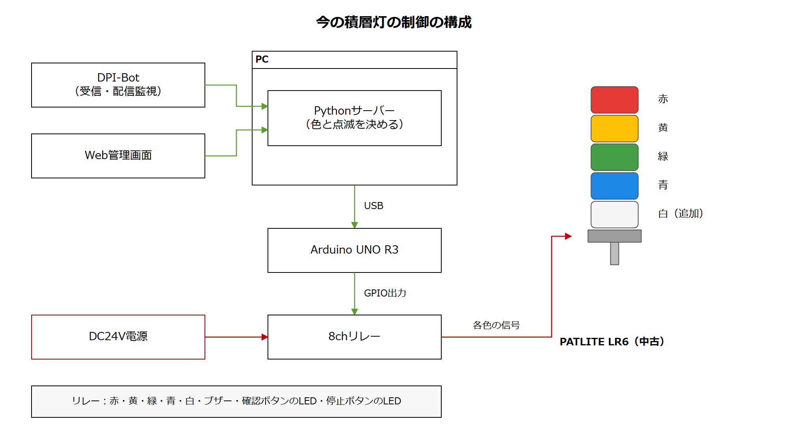
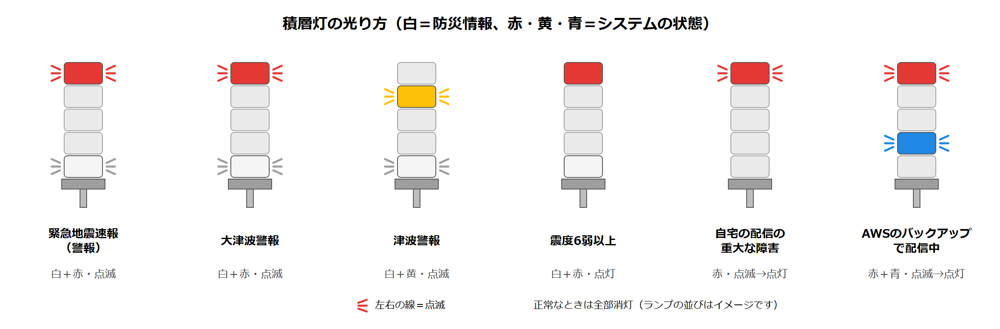
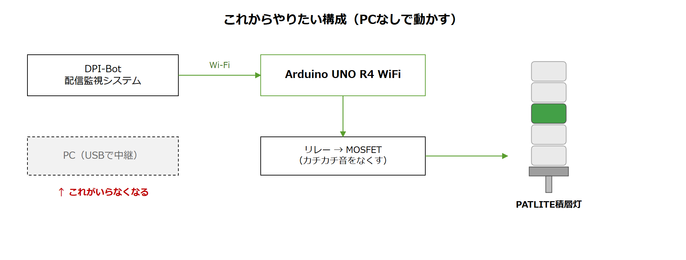
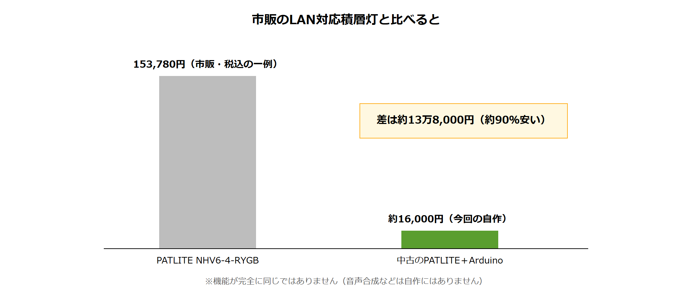

# LAN対応の積層灯が高すぎたので、Arduinoを使って自作してみた話

この記事は、**防災アプリ開発 Advent Calendar 2026** の記事です。

初めましての方は初めまして。お久しぶりの方はお久しぶりです。

Discordに緊急地震速報や地震・津波・気象・火山情報などを配信している「DPI-Bot」を開発・運営している、孤独のコーヒーです。

今年は2枠目の参加となります！

1枠目では、DPI-Botの「Discordへの高速配信と冗長性の両立化」について書きました。

今回は少し方向性を変えて、電子工作のお話です。

突然ですが、皆さんは「積層灯」をご存じでしょうか？

工場などでよく見かける、赤・黄・緑などのランプが縦に積み重なった、あの表示灯です。

今回は、そんな積層灯をArduinoで制御し、ネットワーク経由で操作できるようにした話を書いていきます。

今では、DPI-Botの配信の状態だけでなく、緊急地震速報や大津波警報などの防災情報が出たときにも光るようになりました。

ちなみに、最初から自作するつもりだったわけではありません。

市販のLAN対応積層灯を購入しようとしたところ、値段がなまら高かったんです……。

# そもそもなぜ積層灯なのか

普段、DPI-Botでは緊急地震速報や地震情報、津波情報、気象・火山情報などを受信し、Discordへ配信しています。

また、配信システムが正常に動作しているか確認するため、監視用の画面も作っています。

ただ、これらの情報は基本的にPCやスマートフォンの画面を見なければ分かりません。

寝ているときや別の作業をしているときに、「実は配信が止まってました」となるのが一番怖いんですよね、、、

そこで、配信状態をランプの色や点滅で表示できれば、部屋にいてもシステムの状況を直感的に確認できるのではないかと考えました。

そして、せっかく作るなら、地震や津波などの防災情報を受信した際にもランプを点灯・点滅させたいと思いました。

（もはや自宅なのか工場なのか分からなくなりそうですが……ｗ）

# 最初は市販のLAN対応積層灯を買うつもりだった

最初に検討したのは、市販のネットワーク対応積層灯です。

ネットワーク対応の製品であれば、LAN経由で制御したり、ネットワーク機器を監視したりする機能が最初から用意されています。

まさに自分がやりたいことに近い製品です。

ところが、調べてみると結構なお値段でした。

例えば、PATLITEのネットワーク制御信号灯「NHV6-4-RYGB」は、販売価格の一例で**税込153,780円**。

4段の積層灯で、Ethernet接続に対応しているほか、ブザーや音声合成、ネットワーク監視機能なども備えています。

もちろん業務用としては非常に高機能な製品ですが、趣味で自宅に設置するにはなかなか厳しい価格です。

さすがに積層灯に15万円以上は出せません……。

（去年AWSで400ドル溶かした人間なので、なおさらです）

ちなみに自分は工業高校出身で、在学中は電子回路や電気に関する勉強もしていたため、電子工作には多少自信がありました。

そこで思いついたのが、

**「既製品の積層灯を中古で購入して、制御部分だけ自作すれば安くできるのでは？」**

という方法です。

幸い、Arduinoも高校生のときに購入したものが部屋に転がっていました。

ということで、久しぶりに電子工作をすることにしました。

# 積層灯本体を購入

積層灯本体については、信頼性や見た目も考えて、PATLITE製を選ぶことにしました。

今回購入したのは、**PATLITE LR6-402LJBW-RYGB** です。

| 項目 | 内容 |
|---|---|
| メーカー | PATLITE |
| 型番 | LR6-402LJBW-RYGB |
| 電源 | DC24V |
| ランプ | 赤・黄・緑・青の4段（あとで白を追加して5段に） |
| ブザー | あり |
| 点灯・点滅 | 対応 |
| 購入価格 | 中古で9,000円 |

中古品ですが、ランプとブザーが使えるもので、今回の用途には十分そうでした。

なお、記事を書いている時点では、防災情報用に白色のランプユニットを追加して5段になっています。

# 使用した機材

| 機材 | 用途 |
|---|---|
| Arduino UNO R3 | 制御プログラムの実行 |
| 8ch・5Vリレー基板 | 各色の点灯・消灯 |
| PATLITE積層灯 | 光とブザーによる表示 |
| DC24V電源 | 積層灯への給電 |
| DC-DC降圧モジュール | 制御側の電源構成 |
| 端子台 | 配線の分岐・接続 |
| ヒューズ | 電源系統の保護 |
| 配線・ジャンパーワイヤー | 各機器の接続 |

Arduinoについては、先ほど書いたとおり、高校生のときに購入したものを再利用しているため、今回の追加費用は0円です。

# いざ配線してみると……

【写真：IMG_7057.jpeg ／ Arduino・リレー・端子台などを並べて配線している様子】

今回の制作で一番手間がかかったのが配線です。

Arduinoからリレー基板へ接続する配線に加え、24V電源、積層灯の各色の信号線、端子台など、多くの配線が必要になります。

【写真：IMG_7058.jpeg ／ 積層灯から出ている配線を加工している様子】

最初は配線を整理しながら作業していたのですが、気づいたときには机の上が配線だらけになっていました。

【写真：IMG_7068.jpeg ／ Arduinoと8chリレーを接続した状態】

写真を見ると分かると思いますが、かなりごちゃごちゃしていますｗ

なお、写真は製作途中の様子です。実際に使用する際には、端子の絶縁や配線の固定、電源保護などにも注意する必要があります。

# Arduinoとリレーの制御

今回の制御システムは、Arduino UNO R3と8chリレーを組み合わせています。

Arduinoの出力でリレーを切り替え、積層灯を制御するというシンプルな構成です。

| リレーCH | 用途 |
|---|---|
| CH1 | 赤色ランプ |
| CH2 | 黄色ランプ |
| CH3 | 緑色ランプ |
| CH4 | 青色ランプ |
| CH5 | 白色ランプ |
| CH6 | ブザー |
| CH7 | 確認ボタンの青LED |
| CH8 | 停止ボタンの赤LED |

また、積層灯本体にも点滅用の機能がありますが、今回はArduino側で点滅のタイミングを制御する方法を採用しました。

この方法であれば、赤色だけ点滅させたり、黄色を点灯させたまま白色を点滅させたりといった制御が可能です。

## 実際の動作

【動画：IMG_7069.mp4 ／ Arduinoとリレーによる積層灯の動作テスト】

実際に操作してみると、Arduinoからの制御によってリレーが切り替わり、積層灯が点灯する様子を確認できました。

ただし、ここで新たな問題が発生しました。

# リレーの音が思ったよりうるさい！

今回使用したリレーは、機械式のリレーです。

そのため、リレーが切り替わるたびに「カチッ」という音がします。

単純にランプを点灯・消灯するだけなら、あまり気になりません。

しかし、積層灯を点滅させるとなると話は別です。

点滅に合わせてリレーも何度も切り替わり、複数のランプを同時に点滅させると、その分だけ「カチカチ」が増えていきます。

（ランプの点滅より、リレーのカチカチ音の方が気になる説……）

さらに、機械式リレーは可動接点を使用するため、頻繁に切り替える用途では接点寿命も気になります。

そこで現在、**リレーをMOSFETへ変更するか迷っています。**

MOSFETは半導体による電子的なスイッチなので、機械式リレーのような接点の動作音がありません。

ただし、現在のリレーを単純に置き換えればよいわけではなく、積層灯の24V回路や制御線の仕様に合った回路設計が必要です。

このあたりは今後の改良候補です。

# 今はこんなふうに光っています

最初は「配信が止まったら赤く光ればいいかな」くらいに考えていたのですが、作り始めると欲が出てきて、、、

今は、DPI-Botが受信した防災情報と、配信システムの状態の両方を、色の組み合わせで表示するようになりました。

色の意味は、ざっくり次のように決めています。

| 色 | 意味 |
|---|---|
| 赤 | 配信が止まるような重大な障害 |
| 黄 | 一部の障害・注意 |
| 青 | AWS側の状態・監視が途切れたとき |
| 白 | 防災情報 |

障害の表示には白を使わないので、「白が光っていたら防災情報」とすぐ分かるようにしています。正常なときは全部消灯です。

例えば、

| 起きたこと | 光り方 |
|---|---|
| 緊急地震速報（警報） | 白＋赤の点滅 |
| 大津波警報・津波警報 | 白＋赤／白＋黄の点滅 |
| 震度6弱以上の地震 | 白＋赤の点灯 |
| 自宅の配信プログラムの重大な障害 | 赤の点滅→点灯 |
| AWSのバックアップで配信している | 赤＋青の点滅→点灯 |

のような感じです。

（夜中に白＋赤が点滅したら、だいたい飛び起きます）

また、積層灯の表示が変わったときは、その内容をDiscordのチャンネルにも記録するようにしました。
あとから「さっき何で光ってたんだっけ？」となっても確認できます。

なお、ブザーは家族に怒られそうなので今は使っていませんｗ

**監視画面は詳細を確認するもの、積層灯は変化に気づくためのもの。**

このように役割を分けています。

# ネットワーク経由でも操作できる

今回の積層灯は、DPI-Botから自動で光らせるだけでなく、Webの管理画面からも操作できるようにしています。

ただし、Arduino UNO R3自体には標準でネットワーク機能が搭載されていません。

そのため、現在はPC側でPythonの制御サーバーを動かし、そこからUSB接続されたArduinoへ命令を送る構成になっています。

一応、最初にやりたかったネットワーク経由の操作は実現できています。

ただ、まだ一つ大きな課題があります。

それは、**Arduinoを動作させるためにPC側の制御環境が必要なこと**です。

せっかく積層灯を独立した監視装置として使用するのであれば、常時PCに接続しなければならない構成は少し面倒です。

# 今後はArduino UNO R4 WiFiへ変更したい

現在検討しているのが、Arduino UNO R4 WiFiへの移行です。

UNO R4 WiFiにはWi-Fi機能が搭載されているため、現在のようにPCをUSB接続して命令を中継する必要がなくなります。

この構成にできれば、Arduinoへ適切な電源を供給するだけで、単独のネットワーク制御装置として動作させることができます。

さらに、MOSFET化も同時に行えれば、静音化と単独動作の両方を実現できます。

（Arduinoをグレードアップしたら、また機能を増やしたくなりそうですが……ｗ）

# 結局いくらかかったのか？

さて、やはり気になるのは費用です。

| 部品 | 価格 |
|---|---:|
| PATLITE積層灯（中古） | 9,000円 |
| Arduino UNO R3 | 0円 |
| DC24V電源 | 約2,500円 |
| 8chリレーモジュール | 約1,300円 |
| DC-DC降圧モジュール | 約700円 |
| 端子台・ヒューズ・配線・その他小物 | 約1,000〜3,500円 |
| **合計** | **約14,500〜17,000円** |

※積層灯の9,000円は購入価格、Arduinoは手持ち品のため0円です。その他は部品の価格の目安で、実際の購入総額を厳密に集計したものではありません。あとから追加した白色のランプユニットは含めていません。

ということで、だいたい**16,000円前後**で制作できる計算になります。

## 市販のLAN対応積層灯と比較すると……

| 比較項目 | 市販LAN対応 | 今回の自作 |
|---|---:|---:|
| 本体・制御機器 | 153,780円 | 約16,000円 |
| LAN経由の操作 | 本体で対応 | PC経由で対応 |
| ランプ表示 | 4段 | 5段 |
| ブザー | 対応 | 対応（今は未使用） |
| 音声合成 | 対応 | 非対応 |
| 防災情報との連携 | 自分で作る必要あり | 対応 |
| PCなしで単独動作 | 対応 | 今後対応予定 |

※市販品は税込販売価格の一例であり、機能が完全に同等というわけではありません。

差額は、

**153,780円 − 16,000円 ＝ 137,780円**

なんと、約13万8,000円の差です！

割合で考えると、約90％安く制作できた計算になります。

もちろん、市販品には音声合成やSNMP監視など、今回の自作品にはない機能が搭載されていますし、自作品は制作の時間や今後の保守の手間もあります。

それでも、自分が必要としている「積層灯をネットワーク経由で操作して、防災情報や配信の状態を知らせる」という目的に限れば、かなり費用を抑えることができました。

しかも、制御のプログラムも自分で変更できるため、必要な機能を自由に追加できるのもメリットです。

（浮いた13万円でAWSの料金が何か月分払えるんでしょうかね……ｗ）

# 今後の改良予定

- **リレーのMOSFET化**：頻繁に点滅させる用途では、どうしてもリレーの動作音が気になってしまうため
- **Arduino UNO R4 WiFiへの移行**：PC経由の構成から、Arduino単独でネットワークに接続できる構成へ
- **ネットワークが切れたときや制御プログラムが止まったときの安全性**：今は「監視が途切れたら青く点滅」で気づけるようにしていますが、もう少し詰めたいところです

# 最後に

今回は、中古のPATLITEとArduinoを使って、ネットワーク経由で操作できる積層灯を自作した話を紹介しました。

最初は市販のLAN対応積層灯を買うつもりだったのですが、価格を見て断念し、最終的には制御部分を自作することになりました。

高校時代に購入して、部屋に転がっていたArduinoが役立つとは思っていませんでしたｗ

普段のDPI-Bot開発ではPythonやAWSなど、ソフトウェア側の作業が中心ですが、今回は久しぶりに電子工作をすることができて楽しかったです。

実際に配線して、プログラムからランプが点灯したときは、ソフトウェアだけの開発とは違った面白さがありました。

そして何より、**約1万6,000円で自分の好きなように光らせられる積層灯を作れた**というのが大きかったと思います。

ただ、今回も作り始めたら次々に追加したい機能が増えてしまいました。

（最初はランプを光らせるだけのつもりだったんですがね……）

最後まで読んでいただき、ありがとうございました！

---

**参考：**

- [PATLITE ネットワーク制御信号灯 NHVシリーズ](https://online-shop.patlite.co.jp/c/network/NHV)
- [PATLITE NHV6-4-RYGBの販売価格・仕様（モノタロウ）](https://www.monotaro.com/p/5024/8460/)
- [DPI-Bot公式サイト](https://dpi-bot.com/)
